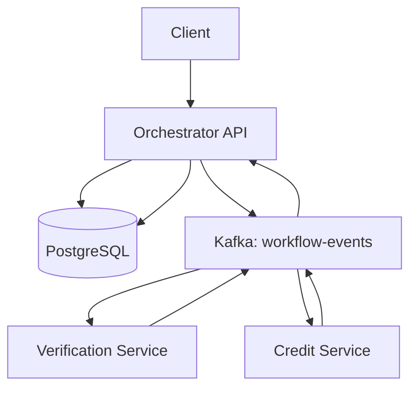

# FlowMaster – Fault-Tolerant Workflow Orchestrator

## Project Overview

FlowMaster is a Node.js-based, event-driven workflow orchestration system that coordinates microservices using Apache Kafka and PostgreSQL. It implements a Saga-style workflow for loan approval, including verification, credit checking, compensation, and basic recovery of incomplete workflows.

## Technology Stack

* Node.js and Express.js
* Apache Kafka with KafkaJS
* PostgreSQL
* YAML workflow configuration
* Docker

## Architecture



## Loan Approval Saga

1. The client creates a workflow.
2. The Orchestrator records the workflow in PostgreSQL.
3. The Verification Service processes the verification event.
4. The Credit Service evaluates the loan amount.
5. If approved, the workflow status becomes `APPROVED`.
6. If rejected, the Orchestrator initiates verification compensation.
7. After compensation completes, the workflow status becomes `REJECTED`.

## Workflow Configuration

The Saga definition is stored in `workflows/loan-saga.yaml`. It defines the verification and credit-check steps, compensation configuration, and retry settings.

## API Endpoints

### Create a workflow

`POST /workflows`

Example request:

```json
{
  "customerName": "Arpita Test",
  "loanAmount": 60000
}
```

### Retrieve workflow status

`GET /workflows/:id`

The response includes the workflow ID, current status, input, and creation timestamp.

## Verification and Testing

The following scenarios have been tested:

* Loan approval resulting in `APPROVED`
* Loan rejection resulting in `REJECTED`
* Compensation event recorded as `VERIFICATION_COMPENSATED`
* Workflow events persisted in PostgreSQL
* Basic recovery of an incomplete workflow after an Orchestrator restart
* Syntax validation of the updated Orchestrator code

## Reliability

The project includes workflow status checks, Kafka event-based service communication, a PostgreSQL event log, basic recovery logic, and an initial duplicate-event protection implementation. Duplicate-event behavior and crash-window recovery require further dedicated testing.

## Running Locally

## Running Locally

### Prerequisites

* Node.js and npm
* Docker Desktop
* PostgreSQL and Kafka configured through Docker Compose

### Setup

1. Clone the repository:

   ```bash
   git clone https://github.com/arpita-lahane/FlowMaster_ArpitaLahane.git
   cd FlowMaster_ArpitaLahane
   ```

2. Start the infrastructure:

   ```bash
   docker compose up -d
   ```

3. Install dependencies:

   ```bash
   npm install
   ```

4. Configure the required environment variables in your local `.env` file. Do not commit secrets to GitHub.

### Start the Services

Open three separate terminals in the project root.

Terminal 1 — Verification Service:

```bash
npm run start:verification
```

Terminal 2 — Credit Service:

```bash
npm run start:credit
```

Terminal 3 — Orchestrator:

```bash
npm run start:orchestrator
```

### API Usage

Create a workflow:

`POST http://localhost:3000/workflows`

Example JSON request:

```json
{
  "customerName": "Arpita Test",
  "loanAmount": 60000
}
```

Retrieve workflow status:

`GET http://localhost:3000/workflows/{id}`

Replace `{id}` with the workflow ID returned by the create-workflow API.

### Syntax Check

Run the JavaScript syntax checks:

```bash
npm test
```

This command checks JavaScript syntax; it does not run automated integration tests.
