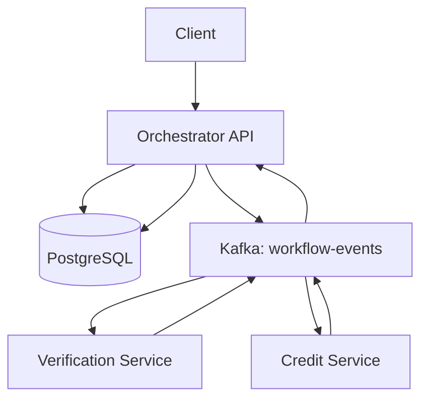

# FlowMaster – Fault-Tolerant Workflow Orchestrator

## Project Overview

FlowMaster is a Node.js-based, event-driven workflow orchestration system that coordinates microservices using Apache Kafka and PostgreSQL. It implements a Saga-style workflow for loan approval, including verification, credit checking, compensation, and basic recovery of incomplete workflows.

## Technology Stack

* Node.js and Express.js
* Apache Kafka with KafkaJS
* PostgreSQL
* YAML workflow configuration
* Docker

## Architecture



## Loan Approval Saga

1. The client creates a workflow.
2. The Orchestrator records the workflow in PostgreSQL.
3. The Verification Service processes the verification event.
4. The Credit Service evaluates the loan amount.
5. If approved, the workflow status becomes `APPROVED`.
6. If rejected, the Orchestrator initiates verification compensation.
7. After compensation completes, the workflow status becomes `REJECTED`.

## Workflow Configuration

The Saga definition is stored in `workflows/loan-saga.yaml`. It defines the verification and credit-check steps, compensation configuration, and retry settings.

## API Endpoints

### Create a workflow

`POST /workflows`

Example request:

```json
{
  "customerName": "Arpita Test",
  "loanAmount": 60000
}
```

### Retrieve workflow status

`GET /workflows/:id`

The response includes the workflow ID, current status, input, and creation timestamp.

## Verification and Testing

The following scenarios have been tested:

* Loan approval resulting in `APPROVED`
* Loan rejection resulting in `REJECTED`
* Compensation event recorded as `VERIFICATION_COMPENSATED`
* Workflow events persisted in PostgreSQL
* Basic recovery of an incomplete workflow after an Orchestrator restart
* Syntax validation of the updated Orchestrator code

## Reliability

The project includes workflow status checks, Kafka event-based service communication, a PostgreSQL event log, basic recovery logic, and an initial duplicate-event protection implementation. Duplicate-event behavior and crash-window recovery require further dedicated testing.

## Running Locally

1. Start the PostgreSQL and Kafka Docker containers.
2. Configure the environment variables in `.env`.
3. Install dependencies using `npm install`.
4. Start the Verification Service, Credit Service, and Orchestrator in separate terminals.
5. Create a workflow using the API and retrieve its status.

## Scope and Limitations

Advanced features such as a transactional outbox, production-grade retry handling, circuit breakers, Redis caching, Prometheus metrics, distributed tracing, and AWS Lambda integration should be considered complete only after implementation and verification.

## Conclusion

FlowMaster demonstrates event-driven microservice orchestration using Kafka, persistent workflow state in PostgreSQL, Saga-style compensation, and basic restart recovery.
